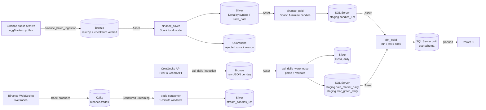
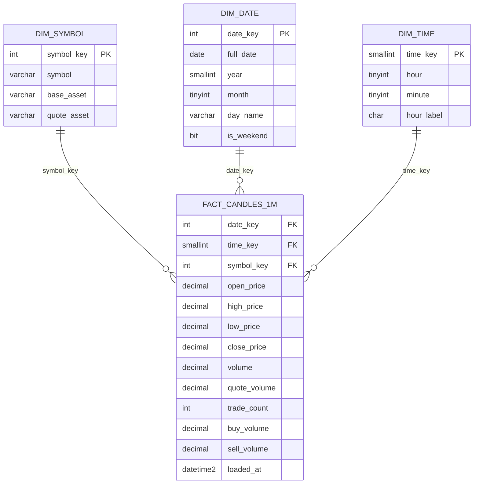

# Crypto Market Data Platform

[](https://github.com/yusuf-kamal/crypto-platform/actions/workflows/ci.yml)

An end-to-end data engineering project that ingests Binance historical trade data, processes it through a Bronze / Silver / Gold (medallion) lake, and serves 1-minute candles from a SQL Server star schema. Built as the Data Pill Data Engineering graduation project.

> **Project status:** the batch path (ingestion → Silver → Gold → dbt) runs end to end on real data. Both source types, the streaming path, orchestrated dbt, observability, Delta Lake, the reporting views and CI are built; the streaming path and the dbt tests on the newer models have not yet been run against live data, and the dashboard is still open. See [Status](#2-status) for the per-area checklist, which says what is verified and what is only written.

---

## 1. Problem and goals

Raw Binance trade files are huge (tens of millions of rows per symbol per month) and unsuitable for direct analytics. This project turns them into a compact, tested, analysis-ready warehouse.

**Business questions the warehouse is designed to answer.** Each one has a tested view in the gold schema, so a BI tool connects to that instead of writing its own joins -- the definition of "volume per hour" or "buy share" lives in this repository and is tested, not inside a dashboard file.

| Question | View |
|---|---|
| 1. Which symbols have the highest trading volume, and at which hours of the day? | `gold.vw_symbol_hourly_activity` |
| 2. How volatile is each symbol over time (high-low range per candle, per hour, per day)? | `gold.vw_symbol_daily_volatility` |
| 3. How does buy volume compare with sell volume for each symbol? | `gold.vw_symbol_buy_sell_balance` |

The volatility view is also where the two sources meet: the candle fact gives the intraday movement, the API facts give that day's market cap and Fear & Greed value next to it.

---

## 2. Status

| Area | State |
|---|---|
| Batch ingestion from Binance public archive (5 symbols x 5 months = 25 files) | Done |
| Second source type: CoinGecko API + Fear & Greed Index API (daily grain) | Done |
| Streaming source (Binance WebSocket -> Kafka -> Spark Structured Streaming) | Code complete, not yet run against the live stream |
| Data lake with Bronze / Silver / Gold buckets (S3-compatible) | Done |
| Silver: Spark typing, cleaning, de-duplication, quarantine | Done |
| Warehouse: SQL Server star schema, dbt incremental models | Done |
| Data quality: 62 Python unit tests, 39 dbt tests | Done. The 62 Python tests pass in CI; of the dbt tests, 13 are verified against real data and the remaining 26 (API facts, reporting views, ops) have been parsed but not yet run |
| Orchestration: 7 Airflow DAGs, chained with Assets where they produce data | Done |
| Airflow task that runs dbt (run, test, docs generate) | Done |
| Gold recomputes only newly processed Silver files | Done |
| Structured logging, run-metrics table, failure alerts | Done (webhook alerting is opt-in through ALERT_WEBHOOK_URL) |
| `ops.vw_pipeline_health`: last run, history and a health verdict per entity | Done |
| Weekly Delta maintenance (`OPTIMIZE` + `VACUUM`) | Done |
| Lineage / data catalog (`dbt docs generate`) | Done |
| Run the whole platform with `docker compose up -d`, SQL Server included | Done |
| Performance tuning with before/after measurements | Done (Silver write path) |
| GitHub Actions CI: ruff, unit tests, DAG import check, `docker compose config`, `dbt parse` | Done |
| Warehouse keys and checks survive a dbt `--full-refresh` | Done |
| Reporting views, one per business question, with their own grain and range tests | Done |
| Power BI dashboard on top of those views | Planned |
| Delta Lake on the Silver layer (atomic writes, `replaceWhere`, time travel) | Code complete, not yet run |
| Iceberg, CDC, Terraform | Not started |

---

## 3. Architecture



**Key idea:** every individual trade stays in the lake (Silver). The warehouse holds one row per symbol per minute, about 1/400 of the trade count, which keeps SQL Server and BI queries fast without losing any detail.

### Star schema (Gold)



**Grain:** one row = one symbol in one minute. All timestamps are **UTC** (as delivered by Binance).

---

## 4. Data

| Item | Value |
|---|---|
| Source | Binance Public Data archive (`data.binance.vision`), spot monthly `aggTrades` |
| Scope | BTCUSDT, ETHUSDT, BNBUSDT, SOLUSDT, XRPUSDT; months 2026-06 to 2026-10 (set in `src/common/config.py`) |
| Gold fact rows | **1,101,600** (220,320 per symbol = 153 days x 1,440 minutes) |
| Silver trade rows | **339,801,204** for the 5x5 scope. Summed from the per-(symbol, month) counts kept in the outputs of `notebooks/01_explore_silver_and_candles.ipynb`; that snapshot of the lake also held two 2026-05 files (BTCUSDT and XRPUSDT) which are outside the final scope and are excluded here |
| Silver rows per symbol (5x5 scope) | BTCUSDT 134,640,856 - ETHUSDT 113,395,176 - BNBUSDT 39,494,244 - XRPUSDT 27,584,014 - SOLUSDT 24,686,914 |

Raw columns of an `aggTrades` file: aggregate trade id, price, quantity, first trade id, last trade id, transact time (microseconds in the 2026 files), is-buyer-maker, is-best-match. Files have no header.

### Source type 2: public REST APIs (daily grain)

| Item | Value |
|---|---|
| CoinGecko | `/coins/{id}/market_chart?vs_currency=usd&days=365` -- daily price, market cap and 24h volume per coin. The free tier returns hourly points below 90 days and daily points above, so 365 keeps the grain daily without a paid `interval` parameter. |
| alternative.me | `/fng/?limit=0` -- the crypto Fear & Greed index, one value per day, market-wide. Every field arrives as a string and the timestamp is in epoch seconds. |
| Grain | One row per day (per symbol for CoinGecko, market-wide for Fear & Greed), joined to the same `gold.dim_date` as the candle fact. |
| Why these two | They answer questions the trade data cannot: how our measured volume compares with the whole market (`market_cap_usd`, `total_volume_usd`) and whether a volatile day was a fearful or a greedy one. |

---

## 5. How to run

### Prerequisites

- Docker Desktop. Developed on Windows 10/11 with the WSL2 backend on a 16 GB machine, WSL limited to 10 GB (`.wslconfig`: `memory=10GB`, `swap=4GB`). macOS works too, with the caveat below.
- **16 GB of host RAM for the full scope.** Docker itself needs 8-10 GB of that, since `SPARK_DRIVER_MEMORY` defaults to `6g` and a driver larger than Docker's limit does not fail with a clear message -- it simply never starts. Check the limit with `docker info` (`MemTotal`); Docker Desktop's own default is often 4 GB, which is not enough. Raise it under Settings -> Resources.
- **On an 8 GB machine** the platform still runs, but not at the configured scope: about 4.8 GB is the practical ceiling for Docker there, so set `SPARK_DRIVER_MEMORY` to `3g` in `.env` and cut `src/common/config.py` down to one or two symbols and a single month. Measured on an 8 GB M2: SQL Server itself settles at roughly 1 GB.
- **On Apple Silicon:** SQL Server publishes no arm64 image (the 2022 manifest is a single-arch amd64 descriptor), so it runs under emulation. `MSSQL_PLATFORM` is already pinned to `linux/amd64` in compose; you also have to switch on "Use Rosetta for x86/amd64 emulation" in Docker Desktop -> Settings -> General. Without it the container exits quietly and `mssql-init` waits for a server that never arrives. Emulation itself is not a problem: measured on an M2, SQL Server 2022 CU28 reports "ready for client connections" about 8 seconds after start and settles at roughly 1 GB. The object store (`pgsty/silo`) and Kafka are multi-arch and need nothing.
- Free local ports: `8085` (Airflow UI), `9000`/`9001` (S3 API / console), `14330` (SQL Server), `8888` (Jupyter, optional).
- No SQL Server installation on the host: it runs in Compose. To use a host instance instead, see [Limitations](#9-known-limitations).

### Steps

**1. Configure secrets**

```powershell
copy .env.example .env
```

Fill in `.env` (never commit it). The file lists every variable with a comment; the ones that need a value from you:

| Variable | Purpose |
|---|---|
| `MINIO_ROOT_USER`, `MINIO_ROOT_PASSWORD` | Object storage credentials |
| `POSTGRES_USER`, `POSTGRES_PASSWORD` | Airflow metadata database |
| `AIRFLOW_FERNET_KEY`, `AIRFLOW_JWT_SECRET` | Airflow secrets (see below) |
| `MSSQL_SA_PASSWORD` | SQL Server `sa` password, used only by `mssql-init` |
| `MSSQL_PASSWORD` | Password for `crypto_app`, the least-privilege login the pipeline uses |
| `ALERT_WEBHOOK_URL` | Optional. Empty means failures are logged but not pushed anywhere |
| `LAKE_FORMAT` | `delta` by default. Set it to `parquet` to fall back to the pre-Delta behaviour without touching a job |
| `SPARK_DRIVER_MEMORY` | `6g` by default. Must fit inside the Docker memory limit |
| `MSSQL_PLATFORM` | `linux/amd64`. Only change it if Microsoft ever ships an arm64 build |

Generate each Airflow secret with:

```powershell
docker run --rm python:3.12-slim python -c "import secrets,base64; print(base64.urlsafe_b64encode(secrets.token_bytes(32)).decode())"
```

**2. Start the platform**

```powershell
docker compose up -d
```

The first run builds three images, and the Airflow one downloads about 280 MB of Spark jars from Maven -- most of it the single `aws-java-sdk-bundle` at 268 MB. Expect roughly ten minutes before anything starts; it is not hung.

The `mssql-init` service then waits for SQL Server and applies every script in `sql/` in alphabetical order, which is also the correct order:

```text
sql/01_create_gold.sql        database, gold schema, dim_date, dim_time, fact
sql/01b_create_login.sql      the crypto_app login, before anything grants to it
sql/02_seed_dims.sql          dim_date (2025-2027) and dim_time (1,440 rows)
sql/03_create_staging.sql     staging.candles_1m
sql/04_create_api_staging.sql API staging tables + dim_date top-up for 2025
sql/05_create_ops.sql         ops.pipeline_runs (run metrics)
```

Every script is idempotent, so re-running the service changes nothing. The Airflow services wait for it to finish before they start.

- Airflow UI: <http://127.0.0.1:8085> (no login, local use only)
- Object storage console: <http://localhost:9001>
- SQL Server: `localhost,14330`, login `crypto_app` (or `sa` for admin work)

**3. Run the batch pipeline**

Trigger `binance_batch_ingestion` in the Airflow UI. When it finishes, `binance_silver` starts automatically (Asset), then `binance_gold`, then `dbt_build` (`dbt run`, `dbt test`, `dbt docs generate`).

`binance_gold` is incremental: it only turns Silver files into candles that it has not processed before. To recompute the whole scope, trigger it with the config `{"full_refresh": true}`.

**4. Run the API pipeline**

Independent of the Binance path. Trigger `api_daily_ingestion` (or let its `@daily` schedule do it); `api_daily_warehouse` follows through its Asset and also publishes the staging Asset, so `dbt_build` runs afterwards.

**5. Optional: the streaming path**

```powershell
docker compose --profile streaming up -d
```

This starts Kafka, the WebSocket producer (`trade-producer`) and the Spark Structured Streaming consumer (`trade-consumer`). Live 1-minute candles appear under `s3a://silver/stream_candles_1m`, partitioned by symbol, and a candle is only written once its minute is closed by the watermark. Stop it with `docker compose --profile streaming down`.

The streaming candles stay in their own prefix on purpose: the batch layer is complete and reproducible, while the stream only covers the time the consumer was running.

**6. Optional: run dbt by hand, exploration notebook, tests**

```powershell
docker compose --profile tools run --rm dbt run
```

```powershell
docker compose --profile tools run --rm dbt test
```

```powershell
docker compose --profile dev up -d jupyter    # http://localhost:8888
```

```powershell
docker compose exec airflow-scheduler python -m pytest tests -q
```

**Checking on the pipeline.**

```sql
SELECT layer, entity, health, last_status, hours_since_last_run,
       last_rows_rejected, last_seconds
FROM   ops.vw_pipeline_health
WHERE  health <> 'ok'
ORDER  BY layer, entity;
```

**Connecting a BI tool.** Point it at `localhost,14330`, database `CryptoDWH`, login `crypto_app`, and use the three `gold.vw_*` views rather than the fact tables: they already carry the business logic for the questions in section 1, and they are covered by dbt tests.

The compose `dbt` service bind-mounts `./dbt`, so `docs generate` through it writes `dbt/target/` on the host, which `dbt docs serve` can then open. The Airflow DAG runs the same image with the project baked in and keeps its artefacts in the `dbt_target` volume.

---

## 6. Repository layout

```text
dags/
  binance_batch_ingestion.py   Bronze: download, checksum-verify, upload
  binance_silver.py            Silver: one Spark task per (symbol, month)
  binance_gold.py              Gold: candles -> staging, incremental
  api_daily_ingestion.py       Bronze: CoinGecko + Fear & Greed JSON, one file per day
  api_daily_warehouse.py       Silver + staging for the API source
  dbt_build.py                 dbt run / test / docs generate, in the dbt container
  lake_maintenance.py          weekly OPTIMIZE + VACUUM on the Delta tables
src/
  common/
    config.py                  symbols, months, coin ids, lookback
    assets.py                  the Airflow Assets that chain the DAGs
    spark.py                   Spark session factory (S3A, JDBC, Kafka, Delta)
    lake.py                    lake paths, format, replaceWhere, maintenance
    observability.py           structured logging, run metrics, failure alerts
  ingestion/
    api_sources.py             HTTP access to both public REST APIs
  transform/
    silver_aggtrades.py        pure transformation functions (no I/O)
    silver_job.py              Silver I/O + metrics
    gold_candles.py            1-minute candle aggregation (pure)
    gold_job.py                reads Silver, writes staging via JDBC, incremental
    api_daily.py               API JSON -> daily rows + quality gate (pure)
    api_job.py                 API Silver + staging
    maintenance_job.py         Delta OPTIMIZE / VACUUM + reclaimed-bytes metrics
  streaming/
    trade_events.py            Kafka JSON -> typed trades -> candles (pure)
    binance_ws_producer.py     Binance WebSocket -> Kafka (long-running)
    trades_stream_job.py       Structured Streaming: Kafka -> Silver
dbt/
  models/                      dim_symbol, 3 facts, 3 reporting views, ops health view
  macros/                      constraints as hooks, literal custom schemas
  macros/                      key / foreign key / check constraints as hooks
  tests/                       singular data tests
sql/                           DDL, dimension seeds, login, ops table
docker/
  airflow/                     Airflow image (Java, PySpark, JDBC + Kafka jars)
  dbt/                         dbt image with the project baked in (ODBC)
  mssql/init.sh                applies sql/ once SQL Server is up
  streaming/                   small image for the WebSocket producer
tests/                         PySpark + plain Python unit tests
notebooks/                     exploration (outputs kept: they are the row counts quoted in section 4)
docker-compose.yml
pyproject.toml                 ruff + pytest configuration
.dockerignore                  keeps .git and notebooks out of the build context
.github/workflows/ci.yml       CI: lint, tests, DAG import, compose, dbt parse
```

Compose services, always on: SQL Server + its init job, object storage + bucket init, Postgres (Airflow metadata), Airflow (api-server, scheduler, dag-processor, triggerer, init). Optional profiles: `dev` (Jupyter), `tools` (dbt on demand) and `streaming` (Kafka, producer, consumer).

---

## 7. Design decisions

| Decision | Why | Alternatives considered |
|---|---|---|
| **Binance public archive files** for historical data | Complete, free, no rate limits; the REST API would need millions of requests. Files are verified against the published SHA-256 checksum | Binance REST API for history |
| **S3-compatible store (`pgsty/silo`, a community MinIO fork)** | Official MinIO images were removed from Docker Hub in September 2026; the fork keeps the same S3 API and `MINIO_*` variables | Official MinIO images, RustFS, SeaweedFS |
| **Bronze keeps the raw zip untouched** | Re-processing from the original is always possible; no information is lost | Convert to Parquet at ingestion |
| **Spark in `local[4]` mode** | One monthly file is hundreds of MB; a single machine is enough and a Spark cluster would waste RAM. The code is unchanged if `master` is later pointed at a cluster | Spark standalone cluster, pandas |
| **Delta Lake for Silver, partitioned by `symbol` / `trade_date`** | Columnar and partition-pruned like plain Parquet, plus an atomic commit (a dead job leaves nothing behind instead of half a write), `replaceWhere`, and time travel for inspecting a bad run afterwards | Plain Parquet (what this started as), Iceberg, Hudi |
| **`replaceWhere` instead of dynamic partition overwrite** | The job states up front which slice it may replace, and Delta rejects the write if the data does not match. A wrong predicate becomes an error rather than silent data loss | Dynamic partition overwrite, MERGE on `agg_trade_id` (too slow against a 340 M-row table for a whole-file reload) |
| **Delta as jars, not the `delta-spark` pip package** | That package pins its own PySpark version, which would fight the 3.5.1 the image is built around, and nothing here needs the Python `DeltaTable` API | pip install delta-spark |
| **1-minute candles as the warehouse grain** | About 1.1 M rows instead of ~100 M+ trades; fine enough to roll up to hour or day | Trade-level fact (too large for SQL Server and BI), hourly candles (too coarse) |
| **Spark for the heavy aggregation, dbt for modeling** | Trades live in the lake and are too large to load into SQL Server; dbt gives incremental merge, tests and lineage on the small candle table | Spark-only Gold layer |
| **Separate `dim_date` and `dim_time`** | `dim_time` is a constant 1,440 rows; a combined date-time dimension would grow with every day | Single `dim_datetime` |
| **Surrogate `symbol_key`, readable `date_key` / `time_key`** | Small integer joins on a 1.1 M-row fact; date/time keys stay human-readable (e.g. 20261031, 1435) | Text symbol in the fact |
| **Airflow 3 Assets to chain DAGs** | Downstream DAG runs when upstream data is actually published; no fixed schedule guessing | Time-based schedules, `TriggerDagRunOperator` |
| **Python for Airflow tasks, separate pure functions** | Transform functions have no I/O, so they are unit-testable | Logic inside the DAG files |
| **dbt in its own container (Python 3.11)** | Pinned, known-good adapter versions (`dbt-core 1.12.6`, `dbt-sqlserver 1.12.1`) separate from the Airflow image (Python 3.13) | Installing dbt in the Airflow image |
| **The API source lands on a daily grain, not minutes** | Both APIs only publish one value per day. Upsampling to minutes would invent data; keeping the natural grain means `dim_date` joins both facts | Forward-filling onto the minute fact |
| **Two separate API facts instead of one** | `fact_coin_market_daily` is per symbol, `fact_fear_greed_daily` is market-wide. Putting the index on the per-symbol fact would repeat it five times a day | One wide daily fact |
| **Raw JSON kept untouched in Bronze** | Same reason as the Binance zip: a schema change at the API never costs us the payload we already fetched | Parse on ingestion |
| **API amounts stored as DECIMAL, carried as double** | The values arrive as JSON floats, so they were never exact; the warehouse column is DECIMAL so arithmetic matches the candle fact | Decimal end to end (false precision) |
| **The streaming path writes its own Silver prefix** | The batch layer is complete and reproducible; the stream is fresh but only covers the uptime of the consumer. One table holding both would be neither | Appending stream candles into the batch fact |
| **A long-running Compose service for the stream, not an Airflow task** | Airflow schedules work that ends. An unbounded query would hold a task slot forever and its retries would mean nothing | A continuously triggered DAG, a sensor loop |
| **The producer forwards raw messages and parses nothing** | Same reason Bronze keeps the untouched zip: if the payload changes, the data is already in the topic and can be reparsed | Parse and validate in the producer |
| **Kafka messages keyed by symbol** | Keeps per-symbol ordering inside a partition, which the open/close-by-trade-id logic depends on | No key (round-robin) |
| **dbt orchestrated through the Docker socket** | dbt needs Python 3.11 and Airflow runs 3.13, so it cannot be imported. Starting its image keeps that split and still puts dbt under orchestration | dbt inside the Airflow image, Cosmos, a bash `docker exec` |
| **SQL Server inside Compose** | `docker compose up -d` becomes the entire setup, and `mssql-init` replaces a page of manual SSMS steps | A host installation (what the project started with) |
| **Gold tracks its own processed pairs in object storage** | The Silver manifests already say what exists; a small JSON of what Gold consumed turns that into a watermark without adding a database | A column in SQL Server, Airflow XCom, reprocessing everything |
| **The metrics table is read back as a view, not a dashboard** | A table nobody queries is not observability. One view with a single `health` column is something an alert query, a tile or a human can use, and it lives in the repository under test | A monitoring tool, a Grafana datasource, reading task logs |
| **Maintenance is time-based, not Asset-driven** | `OPTIMIZE` and `VACUUM` are upkeep, not production of data: they must run whether or not a batch arrived that week | Running them at the end of the Silver DAG |
| **Metrics written by the jobs, not by Airflow** | The job is the only place that knows row counts and per-stage timings; Airflow only knows that a task ended | Parsing task logs, a separate collector |
| **Reporting views, not materialised tables** | The fact is 1.1 M rows and a BI tool aggregates that in well under a second. A materialised copy would be one more object that can go stale, and the view definitions are the tested business logic | Materialised aggregate tables, logic inside the dashboard |
| **One owner per table: dbt owns the facts and dim_symbol, SQL owns the seeded dimensions** | A table created by a DDL script and then materialized by dbt loses its constraints on the first `--full-refresh`, silently. Keys and checks are dbt hooks now, so they are restored after every build | DDL-only tables with dbt as a view layer, dbt contracts |

---

## 8. Data quality, idempotency and incremental loading

### Silver (Spark)

- Explicit schema: `decimal(18,8)` for prices and quantities (no floating-point error), `timestamp` from microseconds.
- Timestamp unit is detected from digit count (13 = milliseconds, 16 = microseconds) so older files with a different unit can be read; covered by a unit test, not yet exercised on older real files.
- Derived columns: `side` (BUY / SELL from `is_buyer_maker`), `quote_value = price x quantity`, `trade_date`.
- **Quarantine:** rows are rejected, with a `reject_reason`, when a required field is null or unparseable, price or quantity is not positive, the trade-id range is invalid, or the trade falls outside the file's month. Invalid rows never fail the job. On the real data so far, **0 rows were rejected** (rules are verified by unit tests).
- De-duplication on `(symbol, agg_trade_id)`. The id is unique per symbol, not globally: one job handles one symbol, so de-duplicating on the id alone happened to be correct, but it would have silently deleted real trades the moment a job covered two symbols.
- The write is a single Delta commit scoped with `replaceWhere` to this file's symbol and days, so a re-run can only ever replace its own slice, and a reader never sees a partial write. The quarantine rule that rejects out-of-month trades is what guarantees the written rows satisfy that predicate.
- A per-file manifest (row counts, rejected count, error rate, per-stage timings) is written after each successful run.

### Gold (dbt): 33 tests

- `unique` and `not_null` on keys, `not_null` on `trade_count`.
- `relationships` (referential integrity) from the fact to `dim_symbol`, `dim_date` and `dim_time`.
- Custom tests: grain uniqueness `(date_key, time_key, symbol_key)` and price/volume consistency (`low <= open, close <= high`, volume >= 0, trade_count > 0), the Fear & Greed 0-100 range, and `assert_api_facts_cover_staging`.
- **The reporting views are tested too**, because a wrong `group by` there would double every measure in the dashboard with no other symptom: grain uniqueness on the hourly view, and range invariants (`buy_share` inside [0, 1], `day_high >= day_low`, never more than 60 minutes in an hour).

### Warehouse constraints

dbt owns `dim_symbol` and the three fact tables, so a `--full-refresh` drops and recreates them. Anything a DDL script had declared on those names -- primary key, foreign keys, check constraints -- would be gone, without an error. The constraints are therefore declared in `dbt/macros/warehouse_constraints.sql` and applied as model hooks:

| Table | Constraints restored after every build |
|---|---|
| `dim_symbol` | `PK_dim_symbol (symbol_key)` |
| `fact_candles_1m` | PK on the grain, FKs to all three dimensions, `high >= low`, `volume >= 0 and trade_count > 0` |
| `fact_coin_market_daily` | PK `(date_key, symbol_key)`, FKs to `dim_date` and `dim_symbol`, `price_usd is null or > 0` |
| `fact_fear_greed_daily` | PK `(date_key)`, FK to `dim_date`, `fng_value between 0 and 100` |

Two details make this work on a repeat run. The `not null` step is guarded by `sys.columns.is_nullable`, because once the primary key exists SQL Server rejects even a no-op `ALTER COLUMN` on an indexed column. And `dim_symbol` has a **pre**-hook that drops every foreign key pointing at it: a referenced table cannot be dropped, so a full refresh would otherwise fail. dbt always builds `dim_symbol` before the facts, which re-add their keys straight afterwards.

### API source (Python)

- The raw JSON is written untouched to Bronze under the run's logical date, so a re-run replaces its own day only.
- `market_chart_rows()` joins the three CoinGecko arrays (`prices`, `market_caps`, `total_volumes`) **by timestamp**, not by position: a missing point in one array leaves a null instead of shifting every later value onto the wrong day.
- Parsing never raises on bad input. An unparseable number or timestamp becomes `None`, and `reject_reason()` then decides whether the row is quarantined -- the same "never fail the job" rule as the Silver quarantine. The rules are:

| Reject reason | Applies to | Why |
|---|---|---|
| `null_or_unparseable_date` | both | Without a date the row cannot join `dim_date` at all |
| `partial_or_unparseable_day` | both | CoinGecko's last point is the *running* day, stamped at "now" instead of midnight. Keeping it would make the newest row change on every run |
| `null_price`, `non_positive_price` | market | Same rule as `non_positive_price_or_quantity` in Silver |
| `null_or_unparseable_fng_value`, `fng_value_out_of_range` | Fear & Greed | The index is defined on a 0-100 scale |
| `missing_fng_classification` | Fear & Greed | The label is what the dashboard groups by |

  A missing `market_cap_usd` or `total_volume_usd` is deliberately **not** a reject: CoinGecko omits them now and then, and dropping the row would throw away that day's valid price too. Those columns carry nulls into the fact instead.
- `dim_date` is topped up back to 2025 by `sql/04`, because the fact models join it with an inner join and a missing day would otherwise vanish without an error. `assert_api_facts_cover_staging` fails if that ever happens.

### Streaming (Spark Structured Streaming)

- The same typing and `side` rules as the batch Silver layer, so a streamed candle and a batch candle are comparable.
- There is no quarantine: a stream has no file to replay, and failing an unbounded query over one malformed message would lose live data. `from_json` turns an unparseable message into nulls and `valid_trades()` drops it; the counts show up in the query's progress metrics.
- The **watermark** (2 minutes by default) is what bounds the state: Spark closes a minute and forgets it once no trade that could still belong to it can arrive. Append mode then writes that candle exactly once, so a published Parquet file is never rewritten.
- The checkpoint holds the Kafka offsets and the open window state, which is what makes a restart pick up where it stopped instead of double-counting.

### Observability

- Every job emits one structured JSON line per event through `json_log()`, with a fixed envelope (`ts`, `event`, then the fields).
- Each job also appends a row per processed entity to `ops.pipeline_runs` (layer, entity, status, row counts, seconds, the job's own metrics as JSON). A metrics write that fails is logged and swallowed: observability must never fail the pipeline.
- Every DAG carries an `on_failure_callback` that logs the failure as a structured event and, if `ALERT_WEBHOOK_URL` is set, posts a short message to it. A webhook that cannot be reached must not mask the real error, so that failure is logged too.
- `ops.vw_pipeline_health` reads that table back: one row per (layer, entity) with its last run, its own history for comparison, and a `health` verdict -- `ok`, `quality` (the last run rejected more than 1% of its input), `stale` (nothing for over 48 hours) or `attention` (the last run did not end in `processed`). Checked in that order, so a failure is never hidden behind a reject rate.

### Re-running safely

| Layer | Mechanism |
|---|---|
| Bronze (files) | Existing object keys are skipped; downloads are checksum-verified; 3 retries |
| Bronze (APIs) | The raw JSON is written under the run's logical date, so a re-run replaces its own day only |
| Silver | Per-file manifest; one atomic Delta commit scoped by `replaceWhere` to that file's symbol and days |
| Gold | Processes only the (symbol, month) pairs not in its own watermark file; `full_refresh` recomputes everything |
| Staging | Rebuilt on every run (`truncate` + load); it holds the current batch, never history |
| Warehouse | dbt incremental models merge on each fact's composite key, so a repeated batch does not duplicate rows |
| Stream | Kafka offsets and window state live in the checkpoint; append mode publishes each closed minute once |

---

## 9. Known limitations

- The streaming path is **code complete but has not been run against the live Binance stream**, so its numbers and failure modes are untested. The same holds for the dbt tests on the two API facts.
- The whole platform is still single-node: Spark runs `local[4]`, Kafka is one broker with replication factor 1, and SQL Server is one container. Nothing here survives a machine failure.
- `dbt_build` reaches the Docker daemon through the mounted socket. That gives the Airflow containers full control of the host's Docker, which is fine for a single-user local setup and would not be acceptable anywhere else.
- `trustServerCertificate=true` / `trust_cert: true` is used for SQL Server's self-signed certificate. Do not use it in production.
- Airflow runs without a login and Jupyter without a token; both are bound for local use only.
- To use a SQL Server on the host instead of the container, set `MSSQL_HOST=host.docker.internal` and its port in `.env`, stop the `mssql` service, and apply `sql/` by hand in SSMS (in the order listed in step 2). The firewall rule is then also needed: `New-NetFirewallRule -DisplayName "SQL Server 14330" -Direction Inbound -Protocol TCP -LocalPort 14330 -Action Allow`.
- Committer algorithm v2 (section 10) only applies on the `LAKE_FORMAT=parquet` fallback; Delta commits through its own transaction log and never leaves a partial write visible. The measurements in section 10 were taken on the parquet path.
- `VACUUM` keeps 168 hours of history, which is Delta's own floor: below that it refuses, because a long-running reader could still need those files. So a week of superseded versions is always on disk, and time travel reaches back exactly that far.
- Performance numbers below are single runs on one laptop, not averaged benchmarks, and none of them cover the streaming path.

---

## 10. Performance tuning (measured)

**Workload:** one file, `XRPUSDT` 2026-05, 3,215,247 trades. Spark `local[4]`, 6 GB driver memory, Docker Desktop on a 16 GB laptop.

| # | Change | Write target | Silver write (s) | Whole job (s) |
|---|---|---|---|---|
| 0 | Baseline | S3 store | 410.7 | 472.4 |
| 1 | Baseline (diagnostic) | local disk | 59.4 | 118.5 |
| 2 | + committer algorithm v2 | S3 store | 182.9 | 238.7 |
| 3 | + `repartition("trade_date")` | S3 store | **27.5** | **88.6** |

Stage timings of the final run: download + unzip 2.0 s, read + parse 24.7 s, quarantine 4.4 s, de-duplicate 21.5 s, write 27.5 s.

**Findings**

- Writing the baseline to local disk took 59 s versus 411 s to S3, so most of the cost was the S3 write path, not Spark computation.
- With the default 200 shuffle partitions, each day's folder held **200 tiny Parquet files** (checked on one day); each file is written then copied and deleted by the output committer on object storage. After repartitioning by `trade_date` the same day holds **1 file**.
- Result: Silver write **15x faster**, whole job **5.3x faster**, and far fewer files for downstream readers.

**Other measurements**

| Step | Result |
|---|---|
| Bronze ingestion, 30 files, 2 concurrent downloads (earlier scope, before the final 25-file scope) | 32 min 6 s (download-bound at about 2.7 to 2.9 MB/s) |
| Gold staging build, 5 symbols x 5 months | 379.8 s |
| `dbt run` (dim_symbol + fact_candles_1m, 1.1 M rows) | 27.3 s |
| `dbt test` (13 tests) | 6.9 s |
| Silver, 25 files, total wall-clock | `<TODO: from the Airflow run duration>` |

---

## 11. Challenges and how they were solved

| Challenge | Solution |
|---|---|
| Official MinIO images disappeared from Docker Hub and Quay | Switched to the maintained `pgsty/silo` fork with a pinned tag |
| Airflow 3 image entrypoint prepends `airflow` to unknown commands, so `jupyter lab` failed | Launch Jupyter with `python -m jupyterlab` |
| Spark `OutOfMemoryError` on large monthly files | Raised driver memory (3g to 6g) and the WSL memory limit; reduced scope to fit a 16 GB machine |
| Silver writes very slow (6,000+ tiny files per month) | Diagnosed with per-stage timings, then committer v2 and repartition (section 10) |
| SQL Server error 8645 (timeout waiting for memory) during `dbt run` | Host RAM was exhausted by the WSL VM; freed memory by shutting down WSL, added an index on the staging table |
| Every streaming test failed with `AMBIGUOUS_REFERENCE: t` | Binance names the trade id `t` and the trade time `T`, and Spark resolves names case-insensitively, so a `from_json` struct holding both fields makes every reference to either one fail. Parsing with `get_json_object`, whose JSON paths are case-sensitive, fixes it without turning on `spark.sql.caseSensitive` session-wide |
| dbt silently dropped the star schema's keys | sql/01 created `dim_symbol` and `fact_candles_1m`, but dbt materializes the same names: the first `--full-refresh` replaced them with constraint-free tables. The DDL now stops at the seeded dimensions and every key, foreign key and check is a dbt hook |
| Airflow UI crash (React error #185) with several Airflow instances on `localhost` | Conflicting browser cookies; used `127.0.0.1` and stopped unrelated containers |
| Port conflicts and Docker Desktop instability with many containers running | Mapped Airflow to port 8085; stopped unrelated projects while working |

---

## 12. Security notes

- Secrets live only in `.env` (git-ignored); `.env.example` lists variable names with comments and no values.
- The pipeline uses a least-privilege SQL login (`crypto_app`), not `sa` or `db_owner`.
- The Jupyter port is bound to `127.0.0.1`.
- `sa` is used by the `mssql-init` service only, to create the database and the `crypto_app` login. Nothing in the pipeline connects as `sa`.
- `dbt_build` mounts the host Docker socket into the Airflow containers, which effectively grants them root on the host. Acceptable for a local single-user setup, not beyond it; a Kubernetes or Celery setup would use a proper executor instead.
- Kafka listens on PLAINTEXT with no authentication. It is only reachable inside the Compose network -- no port is published to the host.
- If a SQL Server on the host is used instead of the container, remove the firewall rule when it is not needed: `Remove-NetFirewallRule -DisplayName "SQL Server 14330"`.

---

## 13. Versions

Airflow 3.3.2 (Python 3.13) · PySpark 3.5.1 · Java 17 · hadoop-aws 3.3.4 · Microsoft JDBC driver 13.4.0 (jre11) · Postgres 16 · dbt-core 1.12.6 · dbt-sqlserver 1.12.1 · pyodbc 5.3.0 · ODBC Driver 18 for SQL Server · `pgsty/silo` RELEASE.2026-09-16T00-00-00Z · SQL Server 2022 (Developer, in Compose) · Kafka 3.9.0 (KRaft, single node) · spark-sql-kafka-0-10 3.5.1 · delta-spark 3.2.0 (jars) · websocket-client 1.8.0 · confluent-kafka 2.6.0

## 14. Data source terms

Data comes from Binance's public data archive. Check Binance's terms before redistributing the data; this repository does not include raw data files.