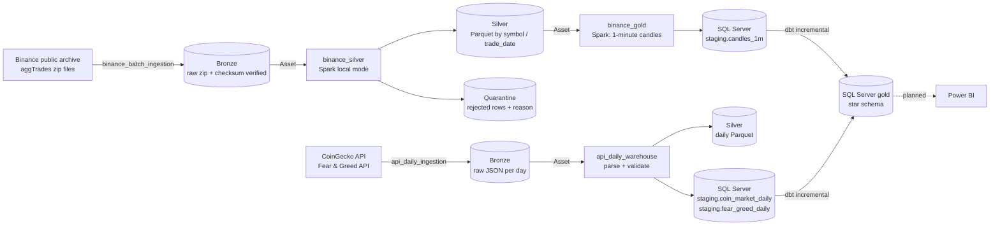
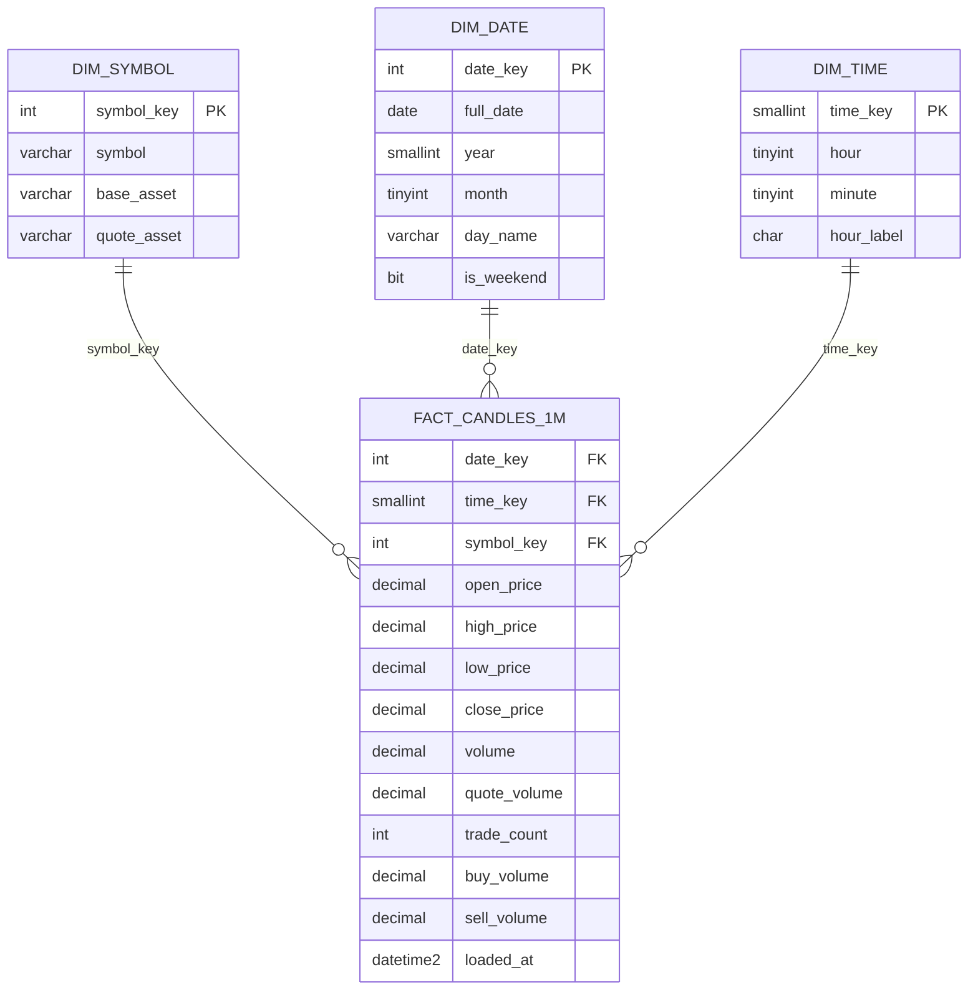

# Crypto Market Data Platform

An end-to-end data engineering project that ingests Binance historical trade data, processes it through a Bronze / Silver / Gold (medallion) lake, and serves 1-minute candles from a SQL Server star schema. Built as the Data Pill Data Engineering graduation project.

> **Project status:** the batch path (ingestion → Silver → Gold → dbt tests) is working end to end. Streaming, additional sources, the dashboard, alerting and CI are **not built yet**; see [Status](#status) for an honest checklist.

---

## 1. Problem and goals

Raw Binance trade files are huge (tens of millions of rows per symbol per month) and unsuitable for direct analytics. This project turns them into a compact, tested, analysis-ready warehouse.

**Business questions the warehouse is designed to answer** (the dashboard that will present them is still planned):

1. Which symbols have the highest trading volume, and at which hours of the day?
2. How volatile is each symbol over time (high-low range per candle, per hour, per day)?
3. How does buy volume compare with sell volume for each symbol?

---

## 2. Status

| Area | State |
|---|---|
| Batch ingestion from Binance public archive (5 symbols x 5 months = 25 files) | Done |
| Data lake with Bronze / Silver / Gold buckets (S3-compatible) | Done |
| Silver: Spark typing, cleaning, de-duplication, quarantine | Done |
| Warehouse: SQL Server star schema, dbt incremental models | Done |
| Data quality: 35 Python unit tests, 24 dbt tests | Done (the 13 candle-path dbt tests are verified; the 11 API tests have not been run yet) |
| Orchestration: 3 Airflow DAGs chained with Assets | Done |
| Performance tuning with before/after measurements | Done (Silver write path) |
| Run the platform with Docker Compose | Partly (SQL Server runs natively, see [Limitations](#9-known-limitations)) |
| Streaming source (Binance WebSocket → Kafka → Spark Structured Streaming) | Planned |
| Second source type: CoinGecko API + Fear & Greed Index API (daily grain) | Done |
| Airflow task that runs dbt (today dbt is run manually through a compose profile) | Planned |
| Power BI dashboard on the Gold layer | Planned |
| Structured logging, metrics table, failure alerts | Planned |
| GitHub Actions CI (ruff lint + PySpark unit tests on every push) | Done |
| Unit tests for the Gold candle function (7 tests) | Done |
| Lineage / data catalog (`dbt docs`), Delta Lake or Iceberg, CDC, Terraform | Not started |

---

## 3. Architecture



**Key idea:** every individual trade stays in the lake (Silver). The warehouse holds one row per symbol per minute, about 1/400 of the trade count, which keeps SQL Server and BI queries fast without losing any detail.

### Star schema (Gold)



**Grain:** one row = one symbol in one minute. All timestamps are **UTC** (as delivered by Binance).

---

## 4. Data

| Item | Value |
|---|---|
| Source | Binance Public Data archive (`data.binance.vision`), spot monthly `aggTrades` |
| Scope | BTCUSDT, ETHUSDT, BNBUSDT, SOLUSDT, XRPUSDT; months 2026-06 to 2026-10 (set in `src/common/config.py`) |
| Gold fact rows | **1,101,600** (220,320 per symbol = 153 days x 1,440 minutes) |
| Silver trade rows | An earlier snapshot (3 symbols, mixed months) measured 214,820,655 trades. Final count for the 5x5 scope: `<TODO: spark.read.parquet("s3a://silver/aggtrades").count()>` |

Raw columns of an `aggTrades` file: aggregate trade id, price, quantity, first trade id, last trade id, transact time (microseconds in the 2026 files), is-buyer-maker, is-best-match. Files have no header.

### Source type 2: public REST APIs (daily grain)

| Item | Value |
|---|---|
| CoinGecko | `/coins/{id}/market_chart?vs_currency=usd&days=365` -- daily price, market cap and 24h volume per coin. The free tier returns hourly points below 90 days and daily points above, so 365 keeps the grain daily without a paid `interval` parameter. |
| alternative.me | `/fng/?limit=0` -- the crypto Fear & Greed index, one value per day, market-wide. Every field arrives as a string and the timestamp is in epoch seconds. |
| Grain | One row per day (per symbol for CoinGecko, market-wide for Fear & Greed), joined to the same `gold.dim_date` as the candle fact. |
| Why these two | They answer questions the trade data cannot: how our measured volume compares with the whole market (`market_cap_usd`, `total_volume_usd`) and whether a volatile day was a fearful or a greedy one. |

---

## 5. How to run

### Prerequisites

- Windows 10/11 with Docker Desktop (WSL2 backend). Developed on a 16 GB machine with WSL limited to 10 GB (`.wslconfig`: `memory=10GB`, `swap=4GB`).
- A SQL Server instance on the host machine with TCP/IP enabled on a fixed port (developed with port `14330`) and SQL authentication allowed.
- Free local ports: `8085` (Airflow UI), `9000`/`9001` (S3 API / console), `8888` (Jupyter, optional).

### Steps

**1. Configure secrets**

```powershell
copy .env.example .env
```

Fill in `.env` (never commit it):

| Variable | Purpose |
|---|---|
| `MINIO_ROOT_USER`, `MINIO_ROOT_PASSWORD` | Object storage credentials |
| `POSTGRES_USER`, `POSTGRES_PASSWORD`, `POSTGRES_DB` | Airflow metadata database |
| `AIRFLOW_FERNET_KEY`, `AIRFLOW_JWT_SECRET` | Airflow secrets (see below) |
| `MSSQL_HOST` (`host.docker.internal`), `MSSQL_PORT`, `MSSQL_DB` (`CryptoDWH`), `MSSQL_USER`, `MSSQL_PASSWORD` | Warehouse connection |

Generate each Airflow secret with:

```powershell
docker run --rm python:3.12-slim python -c "import secrets,base64; print(base64.urlsafe_b64encode(secrets.token_bytes(32)).decode())"
```

**2. Prepare SQL Server** (run in SSMS with an admin login, in this order)

```text
sql/01_create_gold.sql      -- database, gold schema, dim_date, dim_time
sql/02_seed_dims.sql        -- fills dim_date (2026-2027) and dim_time (1,440 rows)
sql/03_create_staging.sql   -- staging.candles_1m
sql/04_create_api_staging.sql -- API staging tables + dim_date top-up for 2025
```

Then create the least-privilege login used by Spark and dbt:

```sql
USE master;
CREATE LOGIN crypto_app WITH PASSWORD = '<your password>', CHECK_POLICY = OFF;
GO
USE CryptoDWH;
CREATE USER crypto_app FOR LOGIN crypto_app;
ALTER ROLE db_datareader ADD MEMBER crypto_app;
ALTER ROLE db_datawriter ADD MEMBER crypto_app;
GRANT CREATE TABLE, CREATE VIEW TO crypto_app;
GRANT ALTER ON SCHEMA::gold TO crypto_app;
GRANT SELECT, INSERT, DELETE, ALTER ON SCHEMA::staging TO crypto_app;
GO
```

Allow the container to reach the host port (run PowerShell as Administrator; consider `-Profile Private`):

```powershell
New-NetFirewallRule -DisplayName "SQL Server 14330" -Direction Inbound -Protocol TCP -LocalPort 14330 -Action Allow
```

**3. Start the platform**

```powershell
docker compose up -d
```

- Airflow UI: <http://127.0.0.1:8085> (no login, local use only)
- Object storage console: <http://localhost:9001>

**4. Run the pipeline**

The API source is independent of the Binance path: trigger `api_daily_ingestion` (or let its daily schedule do it) and `api_daily_warehouse` starts automatically through its Asset.

Trigger `binance_batch_ingestion` in the Airflow UI. When it finishes, `binance_silver` starts automatically (Asset), and when that finishes `binance_gold` starts automatically.

**5. Build and test the warehouse models**

```powershell
docker compose --profile tools run --rm dbt run
docker compose --profile tools run --rm dbt test
```

**Optional: exploration notebook**

```powershell
docker compose --profile dev up -d jupyter    # http://localhost:8888
```

Run the PySpark unit tests inside the Airflow image:

```powershell
docker compose exec airflow-scheduler python -m pytest tests -q
```

---

## 6. Repository layout

```text
dags/
  binance_batch_ingestion.py   Bronze: download, checksum-verify, upload
  binance_silver.py            Silver: one Spark task per (symbol, month)
  binance_gold.py              Gold: candles -> SQL Server staging
  api_daily_ingestion.py       Bronze: CoinGecko + Fear & Greed JSON, one file per day
  api_daily_warehouse.py       Silver + staging for the API source
src/
  common/                      config, Airflow Assets, Spark session factory
  transform/
    silver_aggtrades.py        pure transformation functions (no I/O)
    silver_job.py              Silver I/O + metrics
    gold_candles.py            1-minute candle aggregation (pure)
    gold_job.py                reads Silver, writes staging via JDBC
    api_daily.py               API JSON -> daily rows (pure)
    api_job.py                 API Silver + staging
  ingestion/
    api_sources.py             HTTP access to both public REST APIs
dbt/                           dim_symbol, 3 fact models, tests
sql/                           DDL and dimension seed scripts
docker/                        Airflow image (Java, PySpark, JDBC) and dbt image (ODBC)
tests/                         PySpark + plain Python unit tests
notebooks/                     exploration (outputs cleared)
docker-compose.yml
pyproject.toml                 ruff + pytest configuration
.github/workflows/ci.yml       CI: ruff lint + PySpark unit tests
```

Compose services: object storage + bucket init, Postgres (Airflow metadata), Airflow (api-server, scheduler, dag-processor, triggerer, init). Optional profiles: `dev` (Jupyter) and `tools` (dbt).

---

## 7. Design decisions

| Decision | Why | Alternatives considered |
|---|---|---|
| **Binance public archive files** for historical data | Complete, free, no rate limits; the REST API would need millions of requests. Files are verified against the published SHA-256 checksum | Binance REST API for history |
| **S3-compatible store (`pgsty/silo`, a community MinIO fork)** | Official MinIO images were removed from Docker Hub in September 2026; the fork keeps the same S3 API and `MINIO_*` variables | Official MinIO images, RustFS, SeaweedFS |
| **Bronze keeps the raw zip untouched** | Re-processing from the original is always possible; no information is lost | Convert to Parquet at ingestion |
| **Spark in `local[4]` mode** | One monthly file is hundreds of MB; a single machine is enough and a Spark cluster would waste RAM. The code is unchanged if `master` is later pointed at a cluster | Spark standalone cluster, pandas |
| **Parquet partitioned by `symbol` / `trade_date`** | Columnar, compressed, prunes partitions on reads | CSV, Delta Lake / Iceberg (planned as an advanced feature) |
| **1-minute candles as the warehouse grain** | About 1.1 M rows instead of ~100 M+ trades; fine enough to roll up to hour or day | Trade-level fact (too large for SQL Server and BI), hourly candles (too coarse) |
| **Spark for the heavy aggregation, dbt for modeling** | Trades live in the lake and are too large to load into SQL Server; dbt gives incremental merge, tests and lineage on the small candle table | Spark-only Gold layer |
| **Separate `dim_date` and `dim_time`** | `dim_time` is a constant 1,440 rows; a combined date-time dimension would grow with every day | Single `dim_datetime` |
| **Surrogate `symbol_key`, readable `date_key` / `time_key`** | Small integer joins on a 1.1 M-row fact; date/time keys stay human-readable (e.g. 20261031, 1435) | Text symbol in the fact |
| **Airflow 3 Assets to chain DAGs** | Downstream DAG runs when upstream data is actually published; no fixed schedule guessing | Time-based schedules, `TriggerDagRunOperator` |
| **Python for Airflow tasks, separate pure functions** | Transform functions have no I/O, so they are unit-testable | Logic inside the DAG files |
| **dbt in its own container (Python 3.11)** | Pinned, known-good adapter versions (`dbt-core 1.12.6`, `dbt-sqlserver 1.12.1`) separate from the Airflow image (Python 3.13) | Installing dbt in the Airflow image |
| **The API source lands on a daily grain, not minutes** | Both APIs only publish one value per day. Upsampling to minutes would invent data; keeping the natural grain means `dim_date` joins both facts | Forward-filling onto the minute fact |
| **Two separate API facts instead of one** | `fact_coin_market_daily` is per symbol, `fact_fear_greed_daily` is market-wide. Putting the index on the per-symbol fact would repeat it five times a day | One wide daily fact |
| **Raw JSON kept untouched in Bronze** | Same reason as the Binance zip: a schema change at the API never costs us the payload we already fetched | Parse on ingestion |
| **API amounts stored as DECIMAL, carried as double** | The values arrive as JSON floats, so they were never exact; the warehouse column is DECIMAL so arithmetic matches the candle fact | Decimal end to end (false precision) |

---

## 8. Data quality, idempotency and incremental loading

### Silver (Spark)

- Explicit schema: `decimal(18,8)` for prices and quantities (no floating-point error), `timestamp` from microseconds.
- Timestamp unit is detected from digit count (13 = milliseconds, 16 = microseconds) so older files with a different unit can be read; covered by a unit test, not yet exercised on older real files.
- Derived columns: `side` (BUY / SELL from `is_buyer_maker`), `quote_value = price x quantity`, `trade_date`.
- **Quarantine:** rows are rejected, with a `reject_reason`, when a required field is null or unparseable, price or quantity is not positive, the trade-id range is invalid, or the trade falls outside the file's month. Invalid rows never fail the job. On the real data so far, **0 rows were rejected** (rules are verified by unit tests).
- De-duplication on `agg_trade_id`.
- A per-file manifest (row counts, rejected count, error rate, per-stage timings) is written after each successful run.

### Gold (dbt): 24 tests

- `unique` and `not_null` on keys, `not_null` on `trade_count`.
- `relationships` (referential integrity) from the fact to `dim_symbol`, `dim_date` and `dim_time`.
- Custom tests: grain uniqueness `(date_key, time_key, symbol_key)` and price/volume consistency (`low <= open, close <= high`, volume >= 0, trade_count > 0).

### API source (Python)

- The raw JSON is written untouched to Bronze under the run's logical date, so a re-run replaces its own day only.
- `market_chart_rows()` joins the three CoinGecko arrays (`prices`, `market_caps`, `total_volumes`) **by timestamp**, not by position: a missing point in one array leaves a null instead of shifting every later value onto the wrong day.
- Parsing never raises on bad input. An unparseable number or timestamp becomes `None`, and `reject_reason()` then decides whether the row is quarantined -- the same "never fail the job" rule as the Silver quarantine. The rules are:

| Reject reason | Applies to | Why |
|---|---|---|
| `null_or_unparseable_date` | both | Without a date the row cannot join `dim_date` at all |
| `partial_or_unparseable_day` | both | CoinGecko's last point is the *running* day, stamped at "now" instead of midnight. Keeping it would make the newest row change on every run |
| `null_price`, `non_positive_price` | market | Same rule as `non_positive_price_or_quantity` in Silver |
| `null_or_unparseable_fng_value`, `fng_value_out_of_range` | Fear & Greed | The index is defined on a 0-100 scale |
| `missing_fng_classification` | Fear & Greed | The label is what the dashboard groups by |

  A missing `market_cap_usd` or `total_volume_usd` is deliberately **not** a reject: CoinGecko omits them now and then, and dropping the row would throw away that day's valid price too. Those columns carry nulls into the fact instead.
- `dim_date` is topped up back to 2025 by `sql/04`, because the fact models join it with an inner join and a missing day would otherwise vanish without an error. `assert_api_facts_cover_staging` fails if that ever happens.

### Re-running safely

| Layer | Mechanism |
|---|---|
| Bronze | Existing object keys are skipped; downloads are checksum-verified; 3 retries |
| Silver | Per-file manifest; Parquet written with dynamic partition overwrite |
| Staging | Rebuilt on every Gold run (`truncate` + load) |
| Gold | dbt incremental models merge on the fact's composite key, so a repeated batch does not duplicate rows |

---

## 9. Known limitations

- **Not yet a single-command start.** SQL Server runs natively on the host, so the SQL setup in step 2 is manual. A SQL Server container with an init service is the planned fix.
- The Gold Spark job recomputes the whole configured scope on every run instead of only newly processed files.
- dbt is not yet orchestrated by Airflow.
- Two source types are implemented (Binance archive files, two REST APIs); streaming is still planned.
- `trustServerCertificate=true` / `trust_cert: true` is used for the local SQL Server's self-signed certificate. Do not use it in production.
- Airflow runs without a login and Jupyter without a token; both are bound for local use only.
- Committer algorithm v2 (below) is faster but can leave partial files if a job dies mid-write; jobs are re-run with overwrite, which repairs this.
- Performance numbers below are single runs on one laptop, not averaged benchmarks.

---

## 10. Performance tuning (measured)

**Workload:** one file, `XRPUSDT` 2026-05, 3,215,247 trades. Spark `local[4]`, 6 GB driver memory, Docker Desktop on a 16 GB laptop.

| # | Change | Write target | Silver write (s) | Whole job (s) |
|---|---|---|---|---|
| 0 | Baseline | S3 store | 410.7 | 472.4 |
| 1 | Baseline (diagnostic) | local disk | 59.4 | 118.5 |
| 2 | + committer algorithm v2 | S3 store | 182.9 | 238.7 |
| 3 | + `repartition("trade_date")` | S3 store | **27.5** | **88.6** |

Stage timings of the final run: download + unzip 2.0 s, read + parse 24.7 s, quarantine 4.4 s, de-duplicate 21.5 s, write 27.5 s.

**Findings**

- Writing the baseline to local disk took 59 s versus 411 s to S3, so most of the cost was the S3 write path, not Spark computation.
- With the default 200 shuffle partitions, each day's folder held **200 tiny Parquet files** (checked on one day); each file is written then copied and deleted by the output committer on object storage. After repartitioning by `trade_date` the same day holds **1 file**.
- Result: Silver write **15x faster**, whole job **5.3x faster**, and far fewer files for downstream readers.

**Other measurements**

| Step | Result |
|---|---|
| Bronze ingestion, 30 files, 2 concurrent downloads (earlier scope, before the final 25-file scope) | 32 min 6 s (download-bound at about 2.7 to 2.9 MB/s) |
| Gold staging build, 5 symbols x 5 months | 379.8 s |
| `dbt run` (dim_symbol + fact_candles_1m, 1.1 M rows) | 27.3 s |
| `dbt test` (13 tests) | 6.9 s |
| Silver, 25 files, total wall-clock | `<TODO: from the Airflow run duration>` |

---

## 11. Challenges and how they were solved

| Challenge | Solution |
|---|---|
| Official MinIO images disappeared from Docker Hub and Quay | Switched to the maintained `pgsty/silo` fork with a pinned tag |
| Airflow 3 image entrypoint prepends `airflow` to unknown commands, so `jupyter lab` failed | Launch Jupyter with `python -m jupyterlab` |
| Spark `OutOfMemoryError` on large monthly files | Raised driver memory (3g to 6g) and the WSL memory limit; reduced scope to fit a 16 GB machine |
| Silver writes very slow (6,000+ tiny files per month) | Diagnosed with per-stage timings, then committer v2 and repartition (section 10) |
| SQL Server error 8645 (timeout waiting for memory) during `dbt run` | Host RAM was exhausted by the WSL VM; freed memory by shutting down WSL, added an index on the staging table |
| Airflow UI crash (React error #185) with several Airflow instances on `localhost` | Conflicting browser cookies; used `127.0.0.1` and stopped unrelated containers |
| Port conflicts and Docker Desktop instability with many containers running | Mapped Airflow to port 8085; stopped unrelated projects while working |

---

## 12. Security notes

- Secrets live only in `.env` (git-ignored); `.env.example` lists variable names only.
- The pipeline uses a least-privilege SQL login (`crypto_app`), not `sa` or `db_owner`.
- The Jupyter port is bound to `127.0.0.1`.
- Remove the firewall rule when it is not needed: `Remove-NetFirewallRule -DisplayName "SQL Server 14330"`.

---

## 13. Versions

Airflow 3.3.2 (Python 3.13) · PySpark 3.5.1 · Java 17 · hadoop-aws 3.3.4 · Microsoft JDBC driver 13.4.0 (jre11) · Postgres 16 · dbt-core 1.12.6 · dbt-sqlserver 1.12.1 · pyodbc 5.3.0 · ODBC Driver 18 for SQL Server · `pgsty/silo` RELEASE.2026-09-16T00-00-00Z

## 14. Data source terms

Data comes from Binance's public data archive. Check Binance's terms before redistributing the data; this repository does not include raw data files.