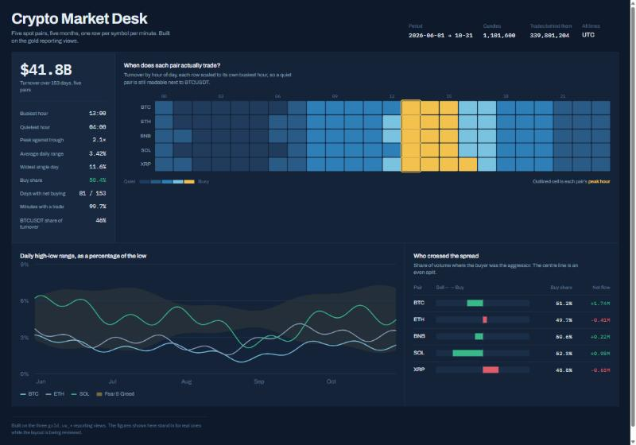

# Power BI report

Everything needed to build the dashboard except the `.pbix` itself: the model,
the measures and the layout. The file has to be assembled in Power BI Desktop
on Windows — a `.pbix` is a binary that only Desktop writes, so it is not in
this repository and nothing here can generate it.

| File | What it is |
|---|---|
| [`measures.dax`](measures.dax) | Every measure, with the reasoning for the ones that are easy to get wrong |
| [`design/dashboard-mockup.html`](design/dashboard-mockup.html) | The intended look, as a page you can open in a browser |
| [`design/dashboard-mockup.jpg`](design/dashboard-mockup.jpg) | A screenshot of the same, for a quick look |



The mockup's figures are representative, for reviewing the layout. It is not
connected to anything.

---

## 1. Connect

Power BI Desktop → **Get data** → **SQL Server**.

| | |
|---|---|
| Server | `localhost,14330` |
| Database | `CryptoDWH` |
| Mode | **Import** |
| Credentials | Database → `crypto_app` and the `MSSQL_PASSWORD` from `.env` |
| Encryption | Untick "Encrypt connection", or trust the certificate — the container's certificate is self-signed |

**Import, not DirectQuery**, and the reporting views are the reason. The fact
table is 1.1 M rows, but nothing in this report reads it:

| Table | Rows at the current scope |
|---|---|
| `gold.vw_symbol_hourly_activity` | 5 symbols × 153 days × 24 hours ≈ **18,360** |
| `gold.vw_symbol_daily_volatility` | 5 × 153 = **765** |
| `gold.vw_symbol_buy_sell_balance` | 5 × 153 = **765** |
| `gold.dim_date` | 1,095 |
| `gold.dim_symbol` | 5 |

About 21,000 rows in total. That imports in seconds and refreshes in seconds,
and every interaction is then instant and works with the warehouse switched
off. DirectQuery would buy nothing and cost a round trip per click.

Load exactly those five tables. Do **not** load `gold.fact_candles_1m`: a
million rows that no visual on the page reads.

## 2. Model

```
dim_date ──┬──< vw_symbol_hourly_activity
           ├──< vw_symbol_daily_volatility
           └──< vw_symbol_buy_sell_balance
                      ^           ^
dim_symbol ───────────┴───────────┘
```

- `dim_date[full_date]` → `full_date` on each of the three views, one-to-many,
  single direction.
- `dim_symbol[symbol]` → `symbol` on each of the three views, one-to-many,
  single direction.
- Mark `dim_date` as the date table, on `full_date`.

Three things worth doing deliberately:

**Use the warehouse's own dimensions, not Power BI's auto date hierarchy.**
`dim_date` already carries `day_name`, `is_weekend`, `month_name` and a
readable `date_key`, and it is the same dimension the facts join to in SQL.
Auto date/time would create a parallel, slightly different calendar per table.
Turn it off under Options → Data Load.

**Hide the join columns.** `full_date` and `symbol` on the three views are
there to join, not to slice: hide them so a report author reaches for the
dimension instead and gets a filter that applies to all three views at once.

**Put the measures in their own table.** Enter data → an empty table called
`Measures` → paste from `measures.dax` → hide its one placeholder column. A
measure's home table does not affect what it computes, and one place to look
is worth more than tidy ownership.

## 3. Pages

The mockup is one page. Three regions, in reading order, each answering one of
the questions from section 1 of the main README.

### Left rail — the headline figures

Five **Card** visuals, stacked, no background and no border. Turn each card's
background off and separate them with a thin line shape; a row of boxed cards
is the look this deliberately avoids.

| Card | Measure | Subtitle underneath |
|---|---|---|
| Turnover | `[Turnover]` | `[Turnover share]` for the largest pair |
| Busiest hour | `[Busiest hour]` | `[Peak to trough ratio]` and `[Quietest hour]` |
| Average daily range | `[Avg daily range %]` | `[Widest daily range %]` and `[Widest range day]` |
| Buy share | `[Buy share]` | `[Net buying days]` out of the days in scope |
| Minutes with a trade | `[Minute coverage]` | how many minutes were empty |

### Hero — hour of day × symbol

A **Matrix**:

- Rows: `dim_symbol[symbol]`
- Columns: `vw_symbol_hourly_activity[hour_utc]`
- Values: `[Turnover vs own peak]`
- Conditional formatting → Background colour → **Rules** or a gradient on that
  measure, from the quiet navy to amber.

Why a matrix and not a chart: 24 hours against 5 pairs is 120 values, and a
grid is the only form that shows all of them without a legend. It is also
native, so there is no custom visual to install or justify.

Two details that decide whether it reads:

- The value is **`[Turnover vs own peak]`, not `[Turnover]`.** Scaled to each
  row's own peak, every pair is readable; with raw turnover the matrix is one
  bright BTCUSDT row and four dark ones.
- Make the quietest colour step clearly lighter than the panel behind it.
  If the low end matches the background, the overnight hours read as *missing
  data* rather than as *little trading* — which is the single most misleading
  thing this page could do.

### Bottom left — volatility over time

A **Line chart**:

- X: `dim_date[full_date]`
- Y: `[Avg daily range %]`
- Legend: `dim_symbol[symbol]` (three pairs is readable; five is a thicket —
  use the slicer)
- Secondary: `[Avg Fear and Greed]` as a light filled area behind, on a second
  axis, 0–100.

The Fear & Greed series is the payoff for having a second source: it puts the
market's mood behind our own measured volatility on the same axis of time.
Keep it visually quiet — it is context, not a competing series.

### Bottom right — who was the aggressor

A **Clustered bar chart** or a table with a data bar:

- Y: `dim_symbol[symbol]`
- X: `[Buy pressure pp]`, which is signed, so the bars diverge around zero
- Colour: conditional, green above zero and red below
- Next to it: `[Buy share]` and `[Net flow]` as numbers

`[Buy pressure pp]` rather than `[Buy share]` because a bar from 48.8% to
51.2% on a 0–100 axis is a flat line; the same values as −1.2 and +1.2
percentage points around zero are a chart.

### Slicers

One for `dim_symbol[symbol]`, one for `dim_date[full_date]` as a range. Put
them in the masthead, not down the side — the page has only one screen of
content and a slicer rail would take a fifth of it.

## 4. Look

Taken from the mockup. Report theme → Customise, or save as a theme JSON.

| Role | Hex | Used for |
|---|---|---|
| Page background | `#0E1A2B` | deep navy, deliberately blue rather than black |
| Visual background | `#142338` | one step up from the page |
| Rail background | `#18293F` | one step up again |
| Divider | `#22364F` | hairlines; never a drop shadow |
| Text | `#E8EEF5` | primary |
| Secondary text | `#8AA0B8` | labels, subtitles |
| Buy | `#39B88A` | only ever means buy-side |
| Sell | `#E05C68` | only ever means sell-side |
| Heat ramp | `#203B5C` → `#2A5A86` → `#2E7FB8` → `#79C2E0` → `#F2C14E` | quiet to busy |

The rule behind the palette: **only three colours carry meaning** — teal for
buy, coral for sell, amber for intensity. Everything else is navy or grey. A
chart element that is coloured is making a claim; if nothing is being claimed,
it stays grey.

Typography: one family, **Archivo** (or Segoe UI, which ships with Windows),
with numbers in a tabular face so digits line up in the matrix and the table.
Titles 15 px semibold, card figures 26 px, labels 12–13 px. No all-caps
labels.

## 5. Before you call it done

- [ ] The matrix shows a visible gradient in the overnight hours, not black
- [ ] `[Buy share]` for one symbol over the whole period is **not** equal to
      the average of its daily `buy_share` column — if it is, the measure was
      written as `AVERAGE()` and is weighting a quiet day like a busy one
- [ ] `[Market cap]` does not grow when you widen the date range
- [ ] A symbol slicer selection changes all four regions
- [ ] The page reads at 1366×768, the smallest laptop likely to open it
